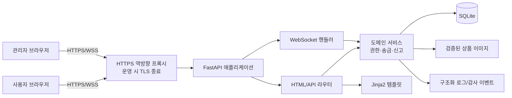
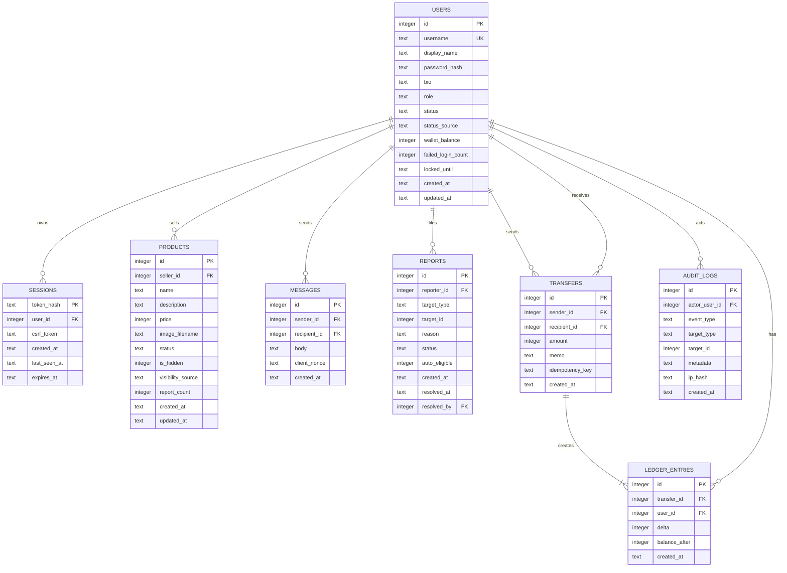
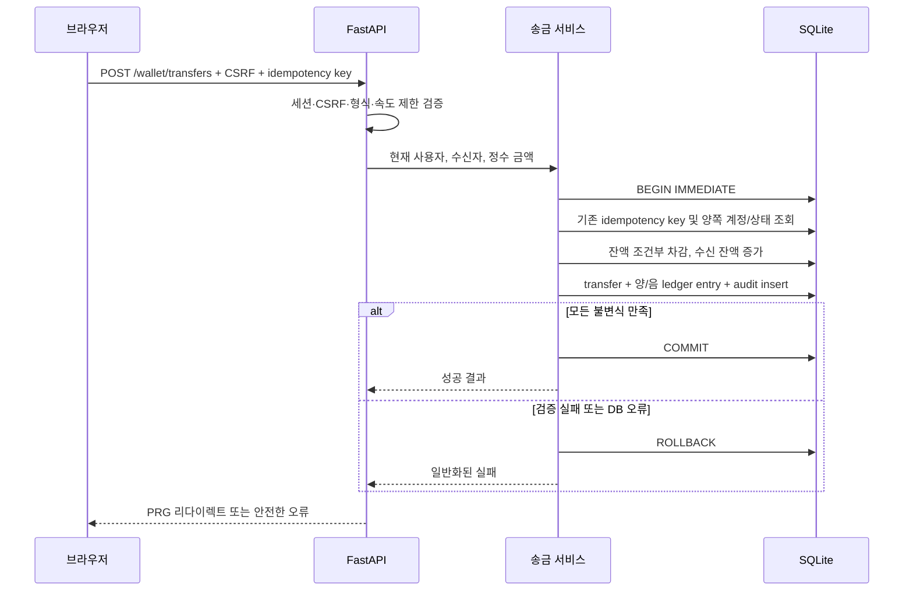

# 시스템 설계

## 1. 설계 목표

이 설계는 강의 슬라이드 p.24~29의 “요구사항을 구현 가능한 시스템으로 구체화한다”는 개발 단계를 따른다. 기능을 빠르게 시연할 수 있는 단일 애플리케이션 구조를 사용하되, 인증·권한·송금·신고·채팅의 신뢰 경계를 분명하게 둔다.

기술 스택은 다음과 같다.

| 계층 | 선택 | 선택 이유 |
|---|---|---|
| HTTP/WebSocket 서버 | FastAPI | 타입 기반 검증, 비동기 WebSocket, 라우터·의존성 분리 |
| 화면 | Jinja2 서버 렌더링 + 최소 JavaScript | 과제 범위에 적합하고 인증·CSRF 흐름을 한 서버에서 통제하기 쉬움 |
| 데이터베이스 | SQLite | 설치 없이 재현 가능하며 트랜잭션·제약조건을 제공. 단일 인스턴스 과제 범위에 적합 |
| 실시간 통신 | FastAPI WebSocket | 전체 및 1:1 채팅의 실제 다중 클라이언트 통신 지원 |
| 스타일/정적 파일 | 로컬 정적 자원 | 외부 CDN 의존과 공급망·CSP 예외를 줄임 |

## 2. 전체 구조

개발 환경에서는 Uvicorn에 직접 접속할 수 있다. 운영 또는 외부 시연에서는 반드시 HTTPS/WSS를 제공하는 역방향 프록시나 안전한 터널을 앞에 둔다. 개발용 HTTP에서만 `Secure` 쿠키를 끄며, 이 차이는 환경설정으로 명시한다.

## 3. 계층과 책임

### 3.1 라우터

- 요청 파싱, 폼/경로/쿼리 스키마 검증
- 현재 사용자와 CSRF 검증 의존성 호출
- 서비스 결과를 Jinja2 템플릿 또는 리다이렉트로 변환
- 예외를 내부 상세가 없는 사용자 메시지로 변환

라우터는 사용자 입력을 SQL 문자열에 이어 붙이지 않는다. 단순 조회는 바인딩 쿼리로 수행할 수 있지만, 잔액 변경·신고 집계처럼 보안에 중요한 변경은 서비스 함수와 하나의 트랜잭션에 모은다.

### 3.2 서비스

- 객체 소유권, 역할, 계정 상태 확인
- 상품 상태 전이, 신고 집계, 가상 KRW 원장 트랜잭션
- 채팅 수신자·방 접근 권한 및 메시지 저장
- 감사 이벤트 생성

보안에 중요한 규칙은 HTML 폼과 WebSocket 양쪽에서 중복 구현하지 않고 서비스 함수 한 곳을 호출한다.

### 3.3 데이터 접근

- 모든 SQL은 `sqlite3` 바인딩 매개변수를 사용한다.
- 연결마다 `PRAGMA foreign_keys=ON`, `busy_timeout=5000`, `journal_mode=WAL`, `synchronous=NORMAL`, `temp_store=MEMORY`, `secure_delete=ON`을 적용한다.
- WAL과 짧은 쓰기 트랜잭션으로 단일 프로세스의 읽기/쓰기 경합을 줄이고, 송금은 `BEGIN IMMEDIATE`로 직렬화한다.
- `PRAGMA user_version=3`과 스키마 초기화 코드로 재현한다.

### 3.4 화면

- Jinja2 자동 이스케이프를 기본값으로 유지한다.
- 사용자 입력에 `|safe`를 적용하지 않는다.
- 상태 변경은 GET 링크가 아니라 CSRF 토큰이 포함된 POST 폼으로 수행한다.
- 성공 후 새로고침에 의한 재실행을 막기 위해 Post/Redirect/Get 패턴을 사용한다.
- JavaScript는 채팅 연결과 필요한 상호작용만 담당하며 권한 판단을 하지 않는다.

## 4. 논리 데이터 모델

### 4.1 주요 제약조건

- `users`, `products`, `messages`, `reports`, `transfers`, `ledger_entries`, `audit_logs`의 `id`: `INTEGER PRIMARY KEY AUTOINCREMENT`; `sessions`는 별도 정수 ID 없이 `token_hash TEXT PRIMARY KEY`
- `users.username`: 대소문자 정책을 일관되게 적용한 고유값
- `users.role`: `user`, `admin` 허용 목록
- `users.status`: `active`, `suspended`, `deleted`; `status_source`: `none`, `auto_report`, `admin`
- `products.price`: 정수 `1..100,000,000`; 상품 상태는 `available`, `reserved`, `sold`, `deleted`
- `products.is_hidden`은 0/1이고 `visibility_source`는 `none`, `auto_report`, `admin`
- `users.wallet_balance`: 정수 `0..1,000,000,000,000`
- `transfers.amount`: 정수 `1..1,000,000`, `sender_id != recipient_id`
- 한 이체에는 송신자 음수·수신자 양수의 원장 항목이 존재하고 합계가 0이어야 함
- `(transfers.sender_id, transfers.idempotency_key)` 고유 제약으로 송신자별 재처리 방지
- `reports`: `(reporter_id, target_type, target_id)` 고유 제약으로 반복 신고 방지
- 1:1 메시지는 `recipient_id`가 있고, 전체 메시지는 `recipient_id`가 `NULL`
- 감사 로그와 원장 행은 일반 CRUD에서 수정·삭제하지 않음

`reports.target_id`는 다형 참조라 데이터베이스 외래키 하나로 완전하게 보장하기 어렵다. 서비스 계층에서 `target_type` 허용 목록과 실제 대상 존재를 함께 검증하고 테스트한다. 실제 구현에서 사용자 신고와 상품 신고 테이블을 분리하면 데이터베이스 수준 무결성을 더 높일 수 있다.

## 5. 라우트 설계

아래 표는 현재 구현의 실제 경로다.

| 영역 | 메서드/경로 | 권한 | 보안 처리 |
|---|---|---|---|
| 홈·검색 | `GET /` (`q`, `page`) | 공개 | 검색 길이/페이지 상한, 바인딩 쿼리, 숨김 상품 제외 |
| 회원가입 | `GET /register`, `POST /register` | 비회원 | CSRF, 입력 정규화·검증, 사용자명 중복 처리, Argon2id |
| 로그인/로그아웃 | `GET /login`, `POST /login`, `POST /logout` | 상황별 | 일반화 오류, 시도 제한, 세션 회전·폐기, CSRF |
| 프로필·설정 | `GET /users/{username}`, `GET /settings`, `POST /settings/profile`, `POST /settings/password` | 조회 공개/변경 본인 | 세션으로 변경 대상 결정, 현재 비밀번호 재확인, 세션 일괄 폐기 |
| 상품 | `GET /products/new`, `POST /products`, `GET /products/{product_id}` | 조회 공개/등록 회원 | 입력·이미지 검증, CSRF |
| 상품 변경 | `GET/POST /products/{product_id}/edit`, `POST /products/{product_id}/delete`, `GET /my/products` | 판매자 | 소유권, 상태 전이, CSRF, 감사 로그 |
| 채팅 | `GET /chat`, `WS /ws/chat` | 활성 회원 | 쿼리/`subscribe`로 전체·DM 선택, 세션·CSRF·Origin·수신자 검증 |
| 신고 | `POST /reports` | 활성 회원 | 폼의 `target_type`·`target_id` 허용 목록, 중복 제한, 감사 로그 |
| 지갑/송금 | `GET /wallet`, `POST /wallet/transfers` | 활성 회원 | CSRF, 멱등 키, 원자적 이체, 속도 제한 |
| 관리자 | `GET /admin`, `POST /admin/users/{user_id}/status`, `POST /admin/products/{product_id}/visibility`, `POST /admin/reports/{report_id}/resolve` | 관리자 | 중앙 RBAC, CSRF, 허용 상태, 감사 로그 |
| 업로드 조회 | `GET /uploads/{filename}` | 해당 공개 상품 | 서버 생성명, 경로 이탈 차단, MIME 고정, nosniff |
| 상태 확인 | `GET /healthz` | 공개 | 민감정보 없는 상태만 반환 |

## 6. 인증과 세션

### 6.1 비밀번호

- 길이 12~128자를 기본 정책으로 하고 제어문자와 NUL을 거부한다.
- 불필요한 조합 규칙보다 충분한 길이와 유출·흔한 비밀번호 방지를 우선한다.
- Argon2id 또는 현재 검증된 적응형 비밀번호 해시를 사용하고 라이브러리가 salt를 생성하게 한다.
- 비교는 라이브러리의 안전한 검증 함수를 사용한다.
- 로그와 예외에 원문 비밀번호·해시를 기록하지 않는다.

### 6.2 세션

브라우저 쿠키에는 예측 불가능한 불투명 토큰만 넣고, 서버 DB에는 SHA-256 토큰 해시와 사용자·만료·CSRF 정보를 저장한다. 비로그인 회원가입·로그인 폼은 별도의 HMAC 보호 CSRF 쿠키를 사용한다.

- 로그인 성공 때 세션 식별자를 새로 발급하여 session fixation을 막는다.
- 쿠키: `HttpOnly`, `SameSite=Lax`, 운영 HTTPS에서 `Secure`, 최소 범위 `Path=/`
- 유휴 만료와 절대 만료를 함께 적용한다.
- 로그아웃, 비밀번호 변경, 계정 정지 시 관련 세션을 폐기한다.
- 비밀번호 변경·중요 관리자 작업은 현재 비밀번호 재확인을 검토한다.

### 6.3 로그인 남용 방지

- 사용자명 존재 여부를 구분하지 않는 오류 메시지를 사용한다.
- 계정과 IP 단위 실패 횟수에 점진적 지연 또는 짧은 잠금을 적용한다.
- 영구 잠금으로 서비스 거부를 만들지 않는다.
- 성공·실패·제한 이벤트를 민감정보 없이 기록한다.

## 7. CSRF와 출력 인코딩

- 상태 변경 폼마다 세션에 묶인 CSRF 토큰을 숨은 필드로 제공한다.
- 서버는 토큰 존재, 세션 결합, 만료를 검증하고 가능한 경우 상수 시간 비교를 사용한다.
- GET 요청은 상태를 변경하지 않는다.
- Jinja2의 HTML 문맥 이스케이프를 사용한다. HTML, 속성, URL, JavaScript 문맥을 섞지 않는다.
- CSP를 적용하고 인라인 스크립트를 줄인다.

WebSocket은 일반 폼 CSRF 토큰만으로 보호되지 않는다. 핸드셰이크에서 세션과 허용된 `Origin`을 검사하고, 교차 출처 WebSocket을 허용하지 않는다.

## 8. 가상 KRW 송금 설계

### 8.1 불변식

1. 잔액은 항상 0 이상인 정수다.
2. 사용자 간 이체의 원장 항목 합계는 항상 0이다.
3. 한 `idempotency_key`는 한 송신자에게 한 번만 처리된다.
4. 송신자는 현재 세션 사용자로만 결정한다.
5. 원장 기록 없이 잔액만 변하거나, 잔액 변화 없이 성공 원장만 생겨서는 안 된다.

### 8.2 처리 순서

SQLite의 단일 쓰기 잠금은 과제 규모에서 이 흐름을 단순하게 한다. 잔액 확인과 차감을 분리된 트랜잭션으로 수행하면 TOCTOU가 생기므로 금지한다. 다중 인스턴스나 실제 금융 서비스로 확장할 때는 전문 데이터베이스, 행 잠금/직렬화, 외부 원장과 조정 작업이 필요하다.

일반 회원가입 계정의 데모 초기 잔액 `100,000 KRW`는 현재 `users.wallet_balance`에 직접 설정되며 genesis/funding 원장 행은 만들지 않는다. 따라서 위 원장 불변식과 변경 이력은 사용자 간 이체가 시작된 뒤의 `transfers` 및 그에 대응하는 두 `ledger_entries`에만 적용된다. 실제 회계 시스템으로 확장하려면 초기 지급도 명시적인 genesis/funding 거래와 원장 항목으로 남겨 전체 잔액의 출처를 조정해야 한다.

## 9. 채팅 설계

### 9.1 연결

- HTTP 로그인과 같은 세션 쿠키를 핸드셰이크에서 검증한다.
- `Origin`을 로컬/운영 허용 목록과 정확히 비교한다.
- 활성 사용자만 연결하고 사용자 ID는 세션에서 결정한다.
- 단일 `/ws/chat` 연결에서 `subscribe` 메시지의 `recipient_id`로 전체/1:1 채널을 선택하며, 상대 사용자의 존재와 상태를 확인한다.
- 연결 관리자에는 사용자별 연결만 보관하며 권한의 영구 출처로 사용하지 않는다.

### 9.2 메시지

- JSON 스키마와 메시지 종류를 허용 목록으로 검증한다.
- 본문은 공백 제거 후 1~500자 등 명시적 범위를 적용한다.
- 클라이언트의 발신자·시각·관리자 표시를 무시하고 서버가 생성한다.
- DB 저장 성공 후 해당 참여자에게만 브로드캐스트한다.
- 전체 채팅과 1:1 채팅 모두 화면 출력 시 이스케이프한다.
- 사용자별 메시지 속도와 동시 연결(사용자당 3개), 전체 연결(80개), 프레임 길이를 제한한다.
- 연결별 송신 잠금과 2초 전송 제한을 두어 느린 수신자 한 명이 전체 fan-out을 막지 않게 한다.

단일 프로세스의 메모리 연결 관리자는 과제 범위에 적합하다. 여러 Uvicorn worker나 서버로 확장하면 Redis Pub/Sub 같은 공유 브로커가 필요하다는 제한을 README와 유지보수 문서에 명시한다.

## 10. 신고·차단 상태 설계

1. 로그인·CSRF·대상·사유·중복을 검증한다.
2. 유효한 신고를 저장하고 감사 이벤트를 남긴다. 가입 후 10분이 지나지 않은 계정의 신고는 저장하되 `auto_eligible=0`으로 두어 자동 제재 집계에서 제외한다.
3. `status`가 `pending` 또는 `actioned`이고 `auto_eligible=1`인 서로 다른 신고자의 수를 트랜잭션 안에서 집계한다.
4. 임계값에 도달하면 아직 공개 상태인 상품은 `is_hidden=1`, `visibility_source='auto_report'`로, 활성 일반 사용자는 `status='suspended'`, `status_source='auto_report'`로 전이한다. 이미 관리자가 숨긴 상품의 `visibility_source='admin'`은 덮어쓰지 않으며 관리자 계정은 자동 정지하지 않는다.
5. 관리자가 신고를 판정하고 감사 로그를 남긴다. 기각 후 재집계 값이 임계값 아래면 출처가 `auto_report`인 제재만 복구하며, `visibility_source='admin'` 또는 `status_source='admin'`인 수동 제재는 유지한다.

자동 차단은 강의 요구를 만족하지만 다수 계정의 공모 신고에 취약하다. 그래서 중복 방지, 속도 제한, 관리자 검토와 복구를 함께 제공한다. 임계값은 코드 곳곳에 하드코딩하지 않고 설정으로 관리한다.

## 11. 상품 이미지

- JPEG/PNG/WebP 등 필요한 래스터 형식만 허용하고 SVG·HTML은 거부한다.
- 확장자와 클라이언트 MIME만 믿지 않고 실제 시그니처를 확인한다.
- 크기와 픽셀 수 상한을 적용하고 이미지 라이브러리로 검증한 뒤 JPEG로 다시 인코딩한다.
- 원본 파일명을 버리고 무작위 서버 파일명을 사용한다.
- 업로드 디렉터리는 실행 코드와 분리하고 사용자가 경로를 선택할 수 없게 한다.
- 응답에 정확한 `Content-Type`과 `X-Content-Type-Options: nosniff`를 제공한다.
- HTTP 요청 본문은 ASGI 계층에서 6 MiB로 제한하고, 사용자별 이미지 저장 개수(3개), 사용자/IP별 업로드 속도, 전체 업로드 할당량(100개)을 함께 적용한다.

## 12. 검색

- 검색어는 길이를 제한하고 문자열 결합 없는 바인딩 쿼리를 사용한다.
- `LIKE` 검색에서 `%`와 `_`를 일반 문자로 다룰지 와일드카드로 다룰지 정책을 정하고 명시적으로 이스케이프한다.
- 공개 상태 필터를 검색 조건에 항상 포함한다.
- 페이지와 페이지 크기를 정수 범위로 제한한다.
- 검색 결과의 상품명·설명도 다른 화면과 동일하게 이스케이프한다.

## 13. 관리자 권한

- 모든 `/admin` 라우트는 공통 `require_admin` 의존성을 사용한다.
- 템플릿에서 버튼을 숨기는 것은 편의 기능일 뿐 권한 통제가 아니다.
- 역할은 요청 파라미터가 아닌 데이터베이스의 현재 사용자 레코드에서 읽는다.
- 역할 변경, 정지, 복구, 상품 숨김, 신고 판정은 허용된 상태 전이만 사용한다.
- 일반 관리 화면에서 비밀번호 해시, 세션 토큰, CSRF 비밀, 전체 원장 수정 기능을 노출하지 않는다.
- 관리자 작업은 CSRF, 재인증 검토, 감사 로그와 속도 제한을 적용한다.

## 14. 공통 보안 헤더와 오류

운영 응답에는 다음 정책을 적용한다.

- `Content-Security-Policy`: 기본·스크립트·스타일·이미지·연결 출처를 `'self'` 중심으로 제한
- `X-Content-Type-Options: nosniff`
- `Referrer-Policy: no-referrer` 또는 필요한 최소 정책
- `frame-ancestors 'none'` 또는 동등한 클릭재킹 방어
- HTTPS 환경에서만 충분히 검토한 `Strict-Transport-Security`
- 민감 페이지 캐시 제한

사용자에게는 요청 ID가 포함된 일반화 오류만 제공하고, 스택 트레이스·SQL·파일 경로·환경변수는 서버 개발 로그에만 남긴다. 운영 로그도 세션 토큰, 비밀번호, CSRF 토큰, 전체 채팅 사생활 정보를 기록하지 않는다.

## 15. 배포와 설정

- 개발: 단일 Uvicorn 프로세스, 로컬 SQLite, 개발용 HTTP
- 외부 시연: HTTPS/WSS 터널 또는 역방향 프록시, 운영 비밀키, `Secure` 쿠키, 허용 호스트·Origin 고정
- 데이터·업로드·백업 경로는 소스와 분리
- `.env`, DB, 업로드, 백업, 로그는 Git에 포함하지 않음
- 기본 관리자 계정과 비밀번호를 코드에 하드코딩하지 않고 명시적 초기화 명령으로 생성

현재 자동 검증은 `pytest` 36개 통과, 분기 커버리지 73%, Ruff 통과, Bandit 이슈 0건, `pip-audit` 취약점 0건이다. 인증·CSRF·XSS·이미지 검증·WebSocket Origin/연결 제한·신고 자동 제재·송금 멱등성/동시성·관리자 RBAC의 핵심 경로를 자동 테스트했다. 다만 실제 HTTPS/WSS 역방향 프록시, 백업 복구 리허설, 고부하 멀티프로세스 운용은 아직 검증하지 않았으므로 운영 준비 완료를 의미하지 않는다.
