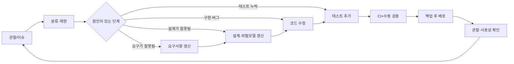

# 유지보수 계획

## 1. 목적

강의 슬라이드 p.33과 녹음은 “정상 작동”만 확인하고 끝내지 말고, 실제 사용 중 불편·버그·서버 오류·잘못된 요구사항을 발견하면 적절한 개발 단계로 돌아가 다시 수행하라고 강조한다. 이 문서는 배포 후 Tiny Second-hand Shopping Platform을 안전하게 유지하기 위한 변경, CI, 백업·복구, 모니터링, 사고 대응 절차를 정의한다.

계획과 현재 증거를 구분한다. 2026-07-22 로컬에서는 Pytest 36개(branch coverage 73%), Ruff, Bandit, pip-audit가 통과했고, public 저장소의 GitHub Actions에서도 같은 품질 게이트가 성공했다. 남은 외부 검증은 실제 HTTPS/WSS 역방향 프록시와 현재 단일 worker 범위를 넘는 고부하 멀티프로세스다. 백업·복구와 모니터링 절은 실제 운영 환경이 생길 때 적용할 유지보수 계획이며, 수행하지 않은 운영 수치를 이미 달성한 것처럼 쓰지 않는다.

## 2. 유지보수 원칙

1. **재현 가능성**: 새 환경에서 README만으로 설치·초기화·실행·테스트할 수 있어야 한다.
2. **작은 변경**: 기능, 보안 수정, 의존성 갱신을 작은 커밋으로 분리하고 회귀 테스트를 함께 추가한다.
3. **데이터 우선**: 마이그레이션·배포 전 백업과 복구 경로를 확인하고 원장·감사 로그를 임의 수정하지 않는다.
4. **최소 권한**: 운영 사용자, 애플리케이션, 관리자 계정, 백업 접근을 필요한 범위로 나눈다.
5. **관찰 가능성**: 요청 ID, 보안 이벤트, 오류를 남기되 비밀번호·세션·CSRF·민감 메시지는 남기지 않는다.
6. **근거 기반 완료**: “코드를 고쳤다”가 아니라 테스트와 시연 증거가 있을 때 완료한다.
7. **위협 모델 갱신**: 새 자산, 외부 서비스, 신뢰 경계가 생기면 `threat-model.md`를 먼저 검토한다.

## 3. 환경과 설정 관리

| 환경 | 목적 | 데이터 | 보안 설정 |
|---|---|---|---|
| 개발 | 로컬 구현·디버깅 | 합성/초기 데이터 | 로컬 HTTP 허용, debug 정보는 개발자에게만, 외부 공개 금지 |
| 테스트/CI | 자동 검증 | 매 실행 새 임시 DB | 고정 테스트 비밀, 네트워크 최소화, 결과에 비밀 미포함 |
| 외부 시연 | 강사 검증·다중 클라이언트 | 과제용 데모 데이터 | HTTPS/WSS, 운영 세션 비밀, Secure cookie, 허용 Host/Origin 고정, debug off |

- 비밀키, 운영 DB, 업로드, 로그, 백업은 Git 저장소 밖에 둔다.
- 환경변수는 코드에 기본 운영 비밀을 제공하지 않는다. 누락 시 안전하게 시작을 거부한다.
- `.env.example`에는 키 이름과 비밀이 아닌 예시만 둔다.
- 개발·운영에서 같은 스키마 버전을 사용하고 설정 차이를 README에 기록한다.
- 외부 시연을 종료하면 터널·서버를 내리고 임시 운영 세션을 폐기한다.

## 4. 변경 관리 흐름

모든 이슈에는 다음을 기록한다.

- 증상과 보안/사용성 영향
- 재현 환경과 최소 절차
- 기대 동작과 실제 동작
- 원인이 생긴 개발 단계
- 수정 내용과 검토한 대안
- 추가한 회귀 테스트
- 배포·롤백·데이터 영향

## 5. 버전과 브랜치

- 보호된 기본 브랜치에 직접 큰 변경을 넣지 않고 기능/수정 브랜치와 리뷰를 사용한다.
- 커밋은 목적을 설명하고 생성 DB, 백업, `.env`, 업로드, 로그를 포함하지 않는다.
- 시연 가능한 버전에는 태그를 붙이고 해당 커밋의 의존성·스키마·설정 방법을 보존한다.
- 데이터베이스 스키마 변경은 애플리케이션 코드와 같은 버전의 명시적 마이그레이션으로 관리한다.
- 이전 애플리케이션으로 롤백할 수 없는 파괴적 마이그레이션은 백업·이중 읽기/쓰기·단계적 제거 계획 없이는 수행하지 않는다.

## 6. CI 품질 게이트

`.github/workflows/ci.yml`은 기본 브랜치 push, pull request, 수동 실행에서 읽기 전용 `contents` 권한으로 다음 작업을 수행하도록 구성했다.

1. Python 3.12 환경 준비와 고정된 개발 의존성 설치
2. Ruff lint와 format check
3. 매 실행 새 임시 SQLite DB를 사용하는 Pytest 및 branch coverage
4. Bandit 애플리케이션 코드 스캔
5. pip-audit strict 의존성 취약점 감사
6. 어느 단계든 실패하면 job 실패

로컬에서 같은 품질 도구는 2026-07-22 모두 통과했다. 테스트에는 pure ASGI의 Content-Length/chunked 6MB 제한, WebSocket 동시 연결·느린 수신자, 서로 다른 키·동일 키 병렬 송금이 포함된다. public 저장소의 push 트리거 GitHub Actions도 Ruff, Pytest, Bandit, strict pip-audit를 모두 통과했다. 워크플로 자체에는 별도 secret scanner와 멀티프로세스 부하 시험이 없으므로, 게시 직전 수행한 추적 파일·이력 수동 secret scan과 규모 확장 검증은 계속 별도 운영 게이트로 둔다.

### 6.1 필수 회귀 테스트 영역

- 회원가입, 로그인 실패 제한, 세션 회전·만료·로그아웃
- 모든 POST의 CSRF 누락·변조·타 세션 토큰
- 상품 소유권과 관리자 권한 매트릭스
- 상품·채팅·신고의 저장형/반사형 XSS
- 검색의 바인딩 쿼리와 경계값
- WebSocket 세션·Origin·DM 참여자·속도 제한
- 신고 중복·임계값·복구
- 가상 KRW의 형식·잔액·멱등·서로 다른 키 및 동일 키 병렬 요청·rollback·원장 합계 0
- Content-Length와 chunked 실제 수신량의 6MB 제한
- WebSocket 인증 전/후 제한, 사용자당 동시 연결, 느린 수신자 격리
- 운영 오류 응답과 로그 비밀정보 비노출

CI 통과는 실제 HTTPS/WSS 역방향 프록시와 멀티프로세스 고부하를 대신하지 않는다. 이 항목은 배포·확장 전에 별도 검증한다.

## 7. 의존성·취약점 관리

### 7.1 정기 점검

- 직접 런타임·개발 의존성은 `==`로 고정하고, 설치 시 해석된 간접 의존성까지 `pip-audit`로 점검한다. GitHub Actions는 검증한 commit SHA로 고정했다. 간접 트리의 lock/hash와 컨테이너 base-image digest 고정은 실제 운영 공급망 하드닝 항목으로 남긴다.
- 2026-07-22 `pip-audit --local` 결과는 알려진 취약점 0건이었다. 취약점 DB는 계속 바뀌므로 제출 직전과 이후 매주 다시 확인한다.
- 보안 패치가 있으면 변경 로그와 호환성을 검토한 뒤 테스트 환경에서 전체 회귀 테스트를 실행한다.
- 사용하지 않는 의존성을 제거하여 공격 표면을 줄인다.
- Python, FastAPI/Starlette, Jinja2, 비밀번호 해시, 이미지 파서, Uvicorn, 프록시는 보안 영향이 크므로 우선 검토한다.

### 7.2 심각도별 목표

| 심각도 | 예 | 대응 목표 |
|---|---|---|
| 긴급 | 인증 우회, 원격 코드 실행, 원장 임의 변경, 운영 비밀 유출 | 즉시 외부 노출 축소·세션/비밀 폐기, 같은 날 수정 또는 안전한 기능 중지 |
| 높음 | 저장형 XSS, 관리자 CSRF, DM·이체 내역 IDOR | 24시간 안에 완화 계획, 우선 패치·회귀 테스트 |
| 중간 | 제한적 정보노출, 반복 가능한 서비스 저하 | 다음 유지보수 릴리스에 수정 |
| 낮음 | 영향이 작은 헤더·사용성 문제 | 우선순위와 함께 백로그 관리 |

이는 과제 규모의 목표이며 실제 운영 SLA를 보장한다는 뜻은 아니다.

## 8. SQLite 운영

### 8.1 파일과 권한

- DB와 WAL/SHM 파일은 소스·정적 파일·웹 공개 경로 밖에 둔다.
- 애플리케이션 OS 계정만 읽기·쓰기가 가능하도록 권한을 제한한다.
- 연결마다 외래키를 활성화하고 `busy_timeout`을 설정한다.
- 쓰기 트랜잭션, 특히 송금과 신고 집계는 가능한 짧게 유지한다.
- 운영 중 DB를 텍스트 편집기나 임의 SQL로 수정하지 않는다.

### 8.2 정기 무결성 점검

- `PRAGMA integrity_check`와 외래키 위반 검사를 백업 또는 유지보수 창에서 실행한다.
- 다음 원장 불변식을 읽기 전용 질의로 확인한다.
  - 사용자 잔액이 음수가 아님
  - 성공 transfer마다 ledger가 정확히 2행
  - 각 transfer의 `SUM(delta_krw) = 0`
  - 송신자와 수신자 원장 부호가 올바름
  - 송신자별 idempotency key가 고유함
- 필요하면 `ANALYZE`를 수행하고, `VACUUM`은 충분한 디스크·백업·중단 시간을 확보한 뒤에만 실행한다.

임시 테스트 DB에서 정상·실패·병렬 송금의 원장 2행·delta 합 0·무초과출금을 자동 확인했다. 별도 운영 DB가 생기면 `PRAGMA integrity_check`, 외래키 위반 검사, 전체 원장 불변식 배치를 정기 유지보수 기록으로 남긴다.

## 9. 백업 정책

### 9.1 보호 대상

- SQLite 주 데이터베이스
- 상품 이미지 파일과 DB의 이미지 참조 관계
- 배포 버전/스키마 버전/필수 환경설정 목록
- 감사 로그(애플리케이션 DB 밖에 보관하는 경우)

비밀 원문은 백업 매체에 불필요하게 복사하지 않는다. 필요한 운영 비밀은 별도 비밀 관리·회전 절차로 관리한다.

### 9.2 백업 방식

- 실행 중 파일을 단순 복사하지 않고 SQLite online backup API 또는 일관된 `.backup`/안전한 스냅샷 절차를 사용한다.
- DB와 이미지의 논리 시점을 맞추기 위해 업로드 쓰기를 짧게 중지하거나 manifest를 기록한다.
- 백업 파일은 날짜·스키마·애플리케이션 버전과 체크섬을 함께 기록한다.
- 운영 데이터와 다른 접근 경계에 저장하고, 외부 저장 시 암호화를 적용한다.
- 백업도 DB와 동일한 민감도로 취급하며 public GitHub, 공유 링크, 로그에 올리지 않는다.

### 9.3 목표 주기와 보존

과제용 외부 시연 환경의 제안 목표:

- 중요 변경·마이그레이션 직전 수동 백업
- 외부 시연 기간 중 하루 1회 백업
- 최근 일일 백업 7개와 주요 릴리스 백업 1개 보존
- 시연 종료 후 필요한 제출 증거를 제외한 개인정보성 데모 데이터를 안전하게 정리

이 주기와 보존은 배포 후 적용할 제안 정책이다. 상시 서비스로 전환하면 업무 요구와 개인정보 보존 정책에 따라 실제 자동화, RPO/RTO 및 보존 기간을 새로 결정하고 측정 결과를 기록한다.

## 10. 복구 리허설

백업은 복원해 보기 전까지 유효하다고 단정하지 않는다.

1. 새 임시 디렉터리와 새 애플리케이션 프로세스를 준비한다.
2. 백업 체크섬과 버전 메타데이터를 확인한다.
3. DB와 이미지 manifest를 복원한다.
4. 스키마 버전이 애플리케이션과 맞는지 확인한다.
5. SQLite integrity/foreign-key 검사와 원장 불변식을 실행한다.
6. 관리자 로그인, 상품 이미지, 검색, DM, 신고, 지갑 내역을 읽기 중심으로 확인한다.
7. 원본 운영 경로를 건드리지 않고 결과와 소요 시간을 기록한다.
8. 임시 복구 데이터는 검증 후 안전하게 제거한다.

과제 운영 목표 RPO는 24시간, 목표 RTO는 2시간으로 둘 수 있으나 실제 서비스의 달성 여부는 배포 후 복구 리허설로 측정한 뒤에만 보고한다.

## 11. 로그와 모니터링

### 11.1 기록할 이벤트

- 애플리케이션 시작·종료·스키마 버전
- 로그인 성공·실패·속도 제한·잠금, 세션 폐기
- 상품 상태 변경, 신고 접수·임계값·관리자 판정
- 송금 성공·거부·중복·rollback(금액과 식별자 노출은 필요한 최소 범위)
- 관리자 권한 작업과 결과
- HTTP 5xx, WebSocket 비정상 종료, DB busy/무결성 오류
- 백업·복구·의존성 점검 결과

### 11.2 기록하지 않을 값

- 비밀번호 원문·해시
- 세션 원문 토큰, CSRF 토큰, 운영 비밀
- 전체 쿠키·Authorization 헤더·전체 폼
- 불필요한 1:1 메시지 본문과 신고의 민감한 자유 입력
- DB 파일·백업 내용

### 11.3 관찰 항목

- 5xx 비율, 로그인 실패 급증, CSRF·Origin 거부 급증
- 메시지·연결·검색·송금 속도 제한 발생
- SQLite busy/rollback, 디스크 사용량, 백업 실패
- 정지·복구·관리자 변경의 비정상 빈도

과제 환경에서는 요청 ID, 감사 이벤트와 재현 가능한 확인 절차를 제공하며 오류 응답의 내부 문자열 비노출을 자동 확인했다. 상시 서비스로 전환할 때 중앙 로그 수집·지표·경보와 장시간 로그 위생 검토를 추가하고, 경보 임계값은 실제 정상 사용 측정 후 정한다.

### 11.4 운영상 잔여 위험

- **Sybil 신고**: 계정 하나의 동일 대상 중복 신고를 막고 가입 후 10분이 지나지 않은 계정의 신고를 자동제재 집계에서 제외하지만, 미리 만든 여러 계정의 공모는 완전히 식별하지 못한다. 자동 조치는 임시 격리로 한정하고 `auto_report` 출처를 기록해 관리자가 기각·복구한다.
- **단일 worker·메모리 rate limit**: 프로세스 안에서는 WebSocket 인증 전 IP 30회/분, 사용자당 동시 3개·전체 80개 연결, 이미지 동시 처리 3개 등 상한을 적용한다. 그러나 연결과 제한 버킷은 메모리에 있어 재시작 시 초기화되고 여러 worker 사이에서 공유되지 않는다. 현재는 worker 1개만 지원하며, 확장 시 Redis 기반 공유 제한과 pub/sub가 필요하다.
- **TLS 역방향 프록시**: 애플리케이션은 production에서 HTTPS Origin과 Secure cookie를 요구하지만 인증서, TLS 종료, WebSocket upgrade, 프록시 헤더 신뢰 설정은 배포 계층 책임이다. 실제 HTTPS/WSS 시연 전에는 운영 완료로 판정하지 않는다.
- **SQLite·로컬 업로드**: 과제 시연 규모의 단일 인스턴스에 맞춘 선택이며 고가용성·다중 서버·실제 금융 거래를 보장하지 않는다.
- **blocking 작업과 thread pool**: async 경로의 SQLite, Pillow, Argon2 처리를 worker thread로 격리하고 이미지 전역 `CapacityLimiter(3)`, 사용자별 rate/quota, 비밀번호 변경 5회/15분 제한을 적용했다. 느린 WebSocket도 2초 timeout과 병렬 fan-out으로 격리한다. 다만 thread pool 포화와 멀티프로세스 전체 서비스 부하 시험은 범위 밖이다.

## 12. 사고 대응

### 12.1 공통 절차

1. **탐지·기록**: 시각, 환경, 증상, 요청 ID, 영향을 보존한다. 비밀은 이슈에 복사하지 않는다.
2. **분류**: 기밀성·무결성·가용성, 영향 사용자, 관리자/원장 영향 여부를 평가한다.
3. **봉쇄**: 외부 노출 중지, 취약 기능 비활성화, 계정 정지, 세션·비밀 폐기 등 가장 작은 안전 조치를 한다.
4. **보존**: 현재 DB와 관련 로그를 일관된 읽기 전용 증거로 보존하되 원본을 임의 수정하지 않는다.
5. **제거·수정**: 원인을 수정하고 회귀 테스트를 추가한다.
6. **복구**: 검증된 백업 또는 수정 버전을 배포하고 무결성 검사를 실행한다.
7. **사후 분석**: 타임라인, 원인, 누락된 통제, 재발 방지, 문서 변경을 기록한다.

### 12.2 특별 상황

**운영 비밀·세션 유출**

- 외부 접근을 제한하고 세션 원문 토큰을 모두 폐기한다.
- 세션 서명/운영 비밀을 회전하고 재로그인을 요구한다.
- Git에 커밋되었다면 현재 파일 삭제만으로 끝내지 않고 이력·포크·캐시 노출 가능성을 평가한다.

**원장 불일치**

- 송금 쓰기를 즉시 중지하고 DB 스냅샷을 보존한다.
- 잔액·transfer·ledger 불변식과 최근 오류/배포를 조사한다.
- 기존 원장 삭제·수정 대신 원인 수정 후 승인된 보정 항목으로 정정한다.

**저장형 XSS**

- 취약 화면을 비활성화하거나 안전한 렌더링을 우선 적용한다.
- 해당 데이터가 관리자 화면에도 표시되었는지 확인하고 필요하면 세션을 폐기한다.
- 모든 출력 문맥과 기존 저장 payload를 점검한다.

**DB/백업 유출**

- 노출 경로를 닫고 접근 로그·범위를 보존한다.
- 비밀번호 해시 비용과 사용자 통지 필요성을 평가하고 비밀번호·세션 초기화를 검토한다.
- 백업 접근권한과 암호화·보존 정책을 수정한다.

## 13. 릴리스·확장 전 외부 점검

- 외부 시연 URL의 실제 TLS 역방향 프록시에서 HTTPS/WSS, `Secure` cookie, HSTS, 정확한 Host/Origin과 WebSocket upgrade를 확인한다. **미배포**
- 다중 worker/프로세스 전환 전 공유 rate limit, 연결 상태, pub/sub, SQLite 쓰기 경합을 고부하 환경에서 시험한다. **현재 단일 worker 범위 밖**
- public 저장소의 GitHub Actions에서 Ruff, Pytest, Bandit, pip-audit 성공을 확인했다. **2026-07-22 통과**

## 14. 유지보수 기록 양식

| 날짜 | 버전/커밋 | 발견 경로 | 증상·영향 | 돌아간 단계 | 수정 | 테스트/증거 | 배포/롤백 | 담당 |
|---|---|---|---|---|---|---|---|---|
| 검증 예정 | - | - | - | - | - | - | - | - |

최종 보고서에는 실제로 발견한 불편·버그·보안 약점만 이 표를 근거로 작성하고, 아직 수행하지 않은 운영 활동을 완료한 것처럼 표현하지 않는다.
