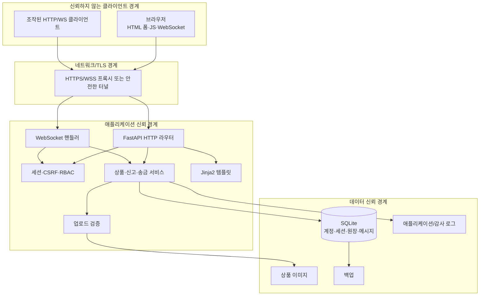

# 위협 모델

## 1. 목적과 범위

이 문서는 Tiny Second-hand Shopping Platform의 인증, 상품, 검색, 전체/1:1 채팅, 신고·차단, 관리자 기능, 데모용 가상 KRW 원장을 STRIDE 방식으로 분석한다. 분석 대상은 브라우저에서 FastAPI/Jinja2/SQLite/WebSocket 애플리케이션까지이며, 실제 은행·카드·결제대행사는 범위 밖이다.

위협 모델은 일회성 결과가 아니다. 요구사항 또는 신뢰 경계가 바뀌면 설계·구현·테스트와 함께 갱신한다. 검증 열은 현재 실행 증거를 반영한다. 기준 결과는 `pytest` 36개 통과(분기 커버리지 73%), Ruff 통과, Bandit 이슈 0건, `pip-audit` 취약점 0건이다.

## 2. 보안 목표

1. 사용자는 다른 사용자를 사칭하거나 다른 사용자의 객체를 변경할 수 없어야 한다.
2. 상품·메시지·신고 입력이 다른 사용자의 브라우저나 서버에서 코드로 실행되지 않아야 한다.
3. 가상 KRW 이체는 인증된 송신자의 명시적 요청 한 번에 원자적으로 한 번만 수행되어야 한다.
4. 관리자 권한과 사용자·상품 상태 변경은 우회할 수 없고 사후 추적 가능해야 한다.
5. 비밀번호, 세션, CSRF 토큰, 운영 비밀, 비공개 1:1 메시지는 필요한 범위 밖으로 노출되지 않아야 한다.
6. 악성 입력·과도한 요청·연결 종료에도 서비스와 데이터 무결성이 유지되어야 한다.

## 3. 자산

| 자산 | 민감도 | 보안 요구 |
|---|---:|---|
| 비밀번호 해시 | 매우 높음 | 기밀성, 강한 해시, 로그·응답 비노출 |
| 세션 원문 토큰·CSRF 토큰 | 매우 높음 | 기밀성, 짧은 수명, 폐기 가능성, 저장 시 세션 토큰 해시화 |
| 관리자 권한 | 매우 높음 | 강한 인증·서버 권한 검사·감사 |
| 사용자 가상 잔액·이체 원장 | 높음 | 무결성, 원자성, 멱등성, 감사 가능성 |
| 1:1 메시지 | 높음 | 참여자 한정 기밀성·무결성 |
| 신고·제재 기록 | 높음 | 무결성, 남용 방지, 감사·복구 |
| 사용자 계정·소개글 | 중간 | 무결성, 최소 공개 |
| 상품·전체 채팅 | 공개/중간 | 무결성, XSS 방어, 가용성 |
| SQLite DB·백업 | 매우 높음 | 파일 접근 통제, 암호화된 보관 검토, 복구 가능성 |
| 감사 로그 | 높음 | 추가 전용, 민감정보 최소화, 시간·행위 추적 |
| 소스·환경설정·비밀키 | 매우 높음 | 저장소 비노출, 변경 통제 |

## 4. 행위자

- **비회원 공격자**: 검색·상품 조회·로그인·회원가입 입력을 조작하거나 자동화한다.
- **악성 회원**: 자신의 정상 계정을 이용해 IDOR, XSS, 스팸, 중복 신고, 이체 조작을 시도한다.
- **공모 계정 집단**: 서로 다른 계정으로 신고 임계값과 속도 제한을 우회한다.
- **탈취된 세션 사용자**: 피해자의 권한으로 상품·채팅·송금을 시도한다.
- **악성 또는 실수한 관리자**: 과도한 조회·상태 변경·로그 조작을 시도하거나 실수한다.
- **외부 네트워크 공격자**: 평문 HTTP/WS를 도청·변조하려 한다.
- **운영 환경 접근자/악성코드**: DB, 백업, 로그, 환경변수에 접근한다.

## 5. 데이터 흐름과 신뢰 경계

핵심 원칙은 브라우저, 숨은 필드, URL의 객체 ID, WebSocket JSON, 파일명, `Origin` 외 모든 헤더도 단독으로 신뢰하지 않는 것이다. 현재 사용자는 서버 세션으로 결정하고, 대상 객체의 소유권·역할·상태를 매 요청마다 서버에서 확인한다.

## 6. 위험 평가 기준

- **영향도**: 높음(H) — 계정/관리자 탈취, 잔액·원장 훼손, 대규모 개인정보 노출 / 중간(M) — 제한된 데이터 변조·노출, 일시 장애 / 낮음(L) — 복구 쉬운 국소 영향
- **가능성**: 높음(H) — 일반 도구로 반복 가능 / 중간(M) — 인증·조건·경쟁 상태 필요 / 낮음(L) — 높은 권한이나 특별 환경 필요
- **우선순위**: H/H와 H/M은 우선 차단, 나머지는 비용과 잔여 위험을 기록하여 처리

## 7. STRIDE 위협 목록

### 7.1 인증·세션·프로필

| ID | STRIDE | 시나리오 | 영향/가능성 | 설계 통제 | 검증 |
|---|---|---|---|---|---|
| TM-AUTH-01 | S | 공격자가 비밀번호 대입·credential stuffing으로 계정을 탈취 | H/H | Argon2id, 일반화 오류, 계정+IP 단위 지연/잠금, 감사 로그 | **부분 통과** — Argon2id·실패 응답 자동 검증; 로그인 잠금 만료 부하는 미검증 |
| TM-AUTH-02 | S/T | 로그인 전 세션을 고정하거나 탈취 쿠키를 재사용 | H/M | 로그인 시 세션 회전, 예측 불가능 토큰, DB에는 SHA-256 토큰 해시만 저장, 만료·폐기, HttpOnly/SameSite/Secure | **부분 통과** — 세션 해시·쿠키 속성·비밀번호 변경 시 전체 세션 폐기는 자동 검증; 명시적 로그아웃 후 재사용은 미자동화 |
| TM-AUTH-03 | T/E | 공격자가 사용자 ID를 바꾸어 타인 프로필·비밀번호 수정 | H/H | 현재 사용자를 세션에서 결정, 본인 소유권 검사, 비밀번호 변경 재인증, CSRF | **통과** — 익명 HMAC CSRF, Origin/CSRF, 세션 사용자 대상 고정 프로필 변경 자동 검증 |
| TM-AUTH-04 | I | 오류 메시지·시간 차이로 사용자명 존재 여부 추측 | M/H | 가입 외 로그인 응답 일반화, 비슷한 처리 흐름, 속도 제한 | **부분 통과** — 존재/부재 오류 일반화는 자동 검증; 정밀 타이밍 측정은 미실시 |
| TM-AUTH-05 | R | 사용자가 “내가 로그인/변경하지 않았다”고 부인 | M/M | 성공·실패·비밀번호 변경·세션 폐기 이벤트를 민감정보 없이 기록 | **부분 통과** — 감사 삽입 코드 확인; 전체 이벤트 내용 매트릭스는 미자동화 |
| TM-AUTH-06 | D | 타인 계정을 반복 실패시켜 영구 잠금 | M/H | 영구 잠금 대신 점진 지연·짧은 만료 잠금, 운영자 복구 | **미검증** — 로그인 잠금 만료·DoS 전용 테스트 없음 |

### 7.2 상품·이미지·검색

| ID | STRIDE | 시나리오 | 영향/가능성 | 설계 통제 | 검증 |
|---|---|---|---|---|---|
| TM-PROD-01 | T/E | URL의 정수 상품 ID를 바꾸어 타인 상품 수정·삭제 | H/H | ID의 불투명성에 의존하지 않고 인증과 별도 소유권 검사, 관리자 작업 분리, 허용 상태 전이 | **통과** — 타 사용자의 편집 화면·수정·삭제 거부 자동 검증 |
| TM-PROD-02 | T/I | 상품명·설명에 저장형 XSS 삽입 | H/H | 길이·형식 서버 검증, Jinja 자동 이스케이프, `safe` 금지, CSP | **통과** — 상품 HTML/이벤트 payload 이스케이프 자동 검증 |
| TM-PROD-03 | T/E/D | HTML/SVG/다중형식·폭탄 이미지 또는 경로 파일명 업로드 | H/M | 래스터 허용 목록, 시그니처·크기·픽셀 검증, JPEG 재인코딩, 서버 생성명, 6 MiB 요청 제한, 사용자당 3개·전체 100개 할당량 | **통과** — SVG, 선언/청크 대용량 요청, 압축 이미지 폭탄, 고아 파일 부재 자동 검증 |
| TM-PROD-04 | I | 숨김/삭제 상품이 직접 URL·검색·이미지 경로로 노출 | M/H | 모든 조회에 공개 상태 필터, 이미지 제공 전 상품 상태 확인 | **부분 통과** — 자동 숨김 상품 직접 상세 404 확인; 캐시·모든 이미지 경로 조합은 미자동화 |
| TM-SEARCH-01 | T/I | 검색어로 SQL injection | H/H | sqlite3 바인딩 매개변수, 동적 열/정렬 허용 목록 | **통과** — SQL 구문 모양 입력을 리터럴로 처리하는 자동 테스트 통과 |
| TM-SEARCH-02 | D | 매우 긴 검색어·큰 페이지·와일드카드로 고비용 조회 반복 | M/H | 길이·페이지 상한, 페이지네이션, 인덱스, 속도 제한 | **부분 통과** — 경계 통제 코드 확인; 반복 부하는 미측정 |

### 7.3 전체·1:1 채팅

| ID | STRIDE | 시나리오 | 영향/가능성 | 설계 통제 | 검증 |
|---|---|---|---|---|---|
| TM-CHAT-01 | S/E | WebSocket payload의 발신자 ID를 바꾸어 사칭 | H/H | 핸드셰이크 세션으로 발신자 결정, 클라이언트 발신자 필드 무시 | **통과** — 전체/DM 메시지의 서버 발신자 결정 자동 검증 |
| TM-CHAT-02 | S/T | 악성 사이트가 피해자 쿠키로 cross-site WebSocket 연결 | H/M | 정확한 Origin 허용 목록, 세션 검증, 연결 후 CSRF 인증 메시지 | **통과** — 비인증·미허용 Origin·불일치 CSRF 연결 거부 자동 검증 |
| TM-CHAT-03 | E/I | `/ws/chat`의 `subscribe.recipient_id`를 바꾸어 다른 대화를 구독·조회 | H/H | 상대 존재·상태 검증, 참여자에게만 이력·브로드캐스트, 서버 채널 구성 | **부분 통과** — 정상 DM 전달은 자동 검증; 가능한 제3자 조합 전체는 미자동화 |
| TM-CHAT-04 | T/I | 메시지로 저장형·DOM XSS 실행 | H/H | 서버 길이·스키마 검증, `textContent`/템플릿 이스케이프, CSP | **부분 통과** — 렌더링 코드 검토 완료; 실제 브라우저 DOM XSS 시연은 미실시 |
| TM-CHAT-05 | D | 메시지 폭주·연결 다중 생성·대형 프레임·느린 수신자 | M/H | 사용자당 연결 3개·전체 80개, 메시지 속도·길이 제한, 연결별 송신 잠금과 2초 제한 | **부분 통과** — 연결 상한·길이·느린 fan-out 자동 검증; 고부하 멀티프로세스는 미검증 |
| TM-CHAT-06 | R | 중복 재전송 또는 발신 부인 | M/M | 송신자별 `client_nonce`, 서버 시각·ID, 중복 제한, 메시지 감사 범위 정책 | **통과** — nonce 중복 재전송 자동 검증 |
| TM-CHAT-07 | I | 평문 WS로 메시지·쿠키 도청 | H/M | 운영 WSS/HTTPS, Secure 쿠키, 안전한 프록시 | **미검증** — 실제 HTTPS/WSS 역방향 프록시 환경 시험 필요 |

### 7.4 신고·차단

| ID | STRIDE | 시나리오 | 영향/가능성 | 설계 통제 | 검증 |
|---|---|---|---|---|---|
| TM-REPORT-01 | T | 같은 사용자가 반복 신고해 임계값 조작 | M/H | `(reporter_id, target_type, target_id)` 고유 제약, 트랜잭션 집계, 속도 제한 | **통과** — 중복 신고 409와 임계값 미증가 자동 검증 |
| TM-REPORT-02 | T/D | 여러 공모 계정이 정상 사용자·상품을 자동 차단 | H/M | 가입 10분 미만 신고는 `auto_eligible=0`; 상품은 `is_hidden`+`visibility_source`, 사용자는 `suspended`+`status_source`; `auto_report` 출처만 기각 복구 | **통과** — 신규 계정 제외, 임계값 제재, 자동 복구, 상품의 `admin` 숨김 보존 자동 검증 |
| TM-REPORT-03 | T/E | `target_type`/`target_id` 변조로 다른 객체 차단 | H/H | 타입 허용 목록, 정수 ID, 타입별 존재·상태 검사, 일관된 대상 키 | **부분 통과** — 상품·사용자 정상 경로 확인; 교차 타입 전체 조합은 미자동화 |
| TM-REPORT-04 | T/I | 신고 사유의 XSS 또는 과도한 개인정보 노출 | M/H | 길이 제한, 출력 이스케이프, 관리자 화면 최소 표시 | **부분 통과** — 공통 템플릿 이스케이프·길이 통제 확인; 전용 payload 테스트 없음 |
| TM-REPORT-05 | R | 관리자 제재·복구 행위 부인 | H/M | actor·대상·판정·시각을 추가 전용 감사 로그에 기록 | **부분 통과** — 자동 제재와 관리자 상태 변경 감사 확인; 일부 이벤트의 변경 전 상태 전체는 기록하지 않음 |

### 7.5 가상 KRW 원장

| ID | STRIDE | 시나리오 | 영향/가능성 | 설계 통제 | 검증 |
|---|---|---|---|---|---|
| TM-LEDGER-01 | S/E | 폼의 sender ID를 바꾸어 타인 잔액에서 송금 | H/H | `POST /wallet/transfers`는 sender 필드를 받지 않고 세션 사용자로 고정, 활성 상태·수신자 검사 | **통과** — 정상·실패·병렬 이체 자동 테스트가 세션 기반 경로 사용 |
| TM-LEDGER-02 | T | 음수·0·소수·초대형 금액으로 잔액 증가·오버플로 유도 | H/H | 정수 파싱, 1~1,000,000 범위, DB CHECK, Python/SQLite 범위 오류 처리 | **부분 통과** — 잔액 부족·자기 송금 무변경 확인; 모든 형식 경계는 미자동화 |
| TM-LEDGER-03 | T | 동시에 두 이체를 보내 잔액보다 많이 사용 | H/M | `BEGIN IMMEDIATE`, 잔액 조건부 차감, 한 트랜잭션에서 양측 갱신+원장 기록 | **통과** — 100,000 잔액에서 70,000 병렬 이체 중 한 건만 성공 |
| TM-LEDGER-04 | T/R | 새로고침·네트워크 재시도로 같은 송금을 두 번 처리 | H/H | 송신자별 idempotency key 고유 제약, 기존 결과 재사용 | **통과** — 순차 및 동시 동일 키에서 이체 1건 확인 |
| TM-LEDGER-05 | T | 사용자 간 이체에서 출금만 반영되거나 원장 없이 잔액 변경 | H/M | 잔액·transfer·양쪽 ledger 2행을 단일 트랜잭션, 오류 시 rollback | **부분 통과** — 정상 불변식과 거부 시 무변경 확인; 임의 실패 지점 주입은 미실시 |
| TM-LEDGER-06 | R/T | 관리자나 공격자가 원장·이체 행을 수정·삭제 | H/M | UI 수정·삭제 경로 없음, `transfers`와 `ledger_entries` UPDATE/DELETE 거부 트리거, DB 파일 권한 | **부분 통과** — 스키마 트리거 확인; 운영 파일 권한 공격 시험은 미실시 |
| TM-LEDGER-07 | I | 다른 사용자의 잔액·이체 내역 조회 | M/H | `/wallet`은 세션 사용자 내역, `/admin`은 RBAC를 통과한 관리자만 조회 | **부분 통과** — 일반 사용자 관리자 접근 거부 확인; 전용 history IDOR 조합은 미자동화 |
| TM-LEDGER-08 | D | 송금 요청 폭주로 SQLite 쓰기 잠금 고갈 | M/H | 속도 제한, 짧은 트랜잭션, `journal_mode=WAL`, `busy_timeout=5000`, 동기 DB 작업의 스레드 오프로딩, 오류 rollback | **부분 통과** — 스레드 병렬 이체 통과; 고부하 멀티프로세스는 미검증 |

### 7.6 관리자·운영

| ID | STRIDE | 시나리오 | 영향/가능성 | 설계 통제 | 검증 |
|---|---|---|---|---|---|
| TM-ADMIN-01 | E | 일반 사용자가 관리자 URL/API를 직접 호출 | H/H | 모든 관리자 라우트의 공통 서버 RBAC, DB role만 신뢰 | **부분 통과** — 대시보드·사용자 상태 변경 거부 자동 검증; 전 라우트 매트릭스는 미자동화 |
| TM-ADMIN-02 | T | 관리자 CSRF로 사용자 정지·상품 숨김 유도 | H/M | 모든 POST의 CSRF·Origin 검증, SameSite, 위험 작업 확인 | **부분 통과** — 공통 CSRF/Origin 거부 자동 검증; 관리자별 모든 조합은 미자동화 |
| TM-ADMIN-03 | T/R | 허용되지 않은 상태 값 삽입 또는 감사 로그 조작 | H/M | 상태 허용 목록, 서비스 함수, UPDATE/DELETE 거부 감사 트리거, DB 파일 권한 | **부분 통과** — 관리자 변경·감사와 스키마 통제 확인; 직접 DB 운영 공격은 미실시 |
| TM-OPS-01 | I/E | `.env`, 비밀키, DB, 백업이 public GitHub에 포함 | H/M | `.gitignore`, 데이터 경로 분리, 커밋 전 검사 | **부분 통과** — ignore 규칙·예제 환경파일 정적 확인; 공개 저장소 이력은 게시 시 재확인 필요 |
| TM-OPS-02 | I | 디버그 오류·로그에 SQL, 경로, 토큰, 비밀번호 노출 | H/H | 운영 debug off, 일반화 예외, 로그 필드 허용 목록·마스킹 | **부분 통과** — 예외 응답 비노출 자동 검증; 운영 로그 전체 점검은 미실시 |
| TM-OPS-03 | T/E | 오래되거나 악성 의존성으로 코드 실행 | H/M | 최소 의존성, 직접 버전·Actions commit SHA 고정, 공식 출처, 의존성 취약점 점검·업데이트 절차 | **부분 통과** — `pip-audit` 알려진 취약점 0건과 Bandit 이슈 0건. 간접 lock/hash와 컨테이너 digest 고정은 남음 |
| TM-OPS-04 | T/I | 백업 유출·손상 또는 복원 불가 | H/M | 접근 제한, 암호화 보관 검토, 체크섬, 보존 정책, 정기 복구 리허설 | **미검증** — 실제 백업 복구 리허설 필요 |
| TM-OPS-05 | S/I | 잘못된 Host/Origin·평문 시연으로 링크와 쿠키 탈취 | H/M | 허용 Host/Origin, 외부 HTTPS/WSS, Secure cookie, 프록시 신뢰 설정 최소화 | **부분 통과** — Origin·Secure/HSTS 설정 자동 검증; 실제 HTTPS/WSS 프록시는 미검증 |
| TM-OPS-06 | D | 여러 worker/프로세스에서 메모리 제한·WebSocket 상태가 분리되어 통제가 우회되거나 부하가 누적 | M/H | 과제 실행은 단일 worker로 제한, 확장 시 Redis 등 공유 브로커·분산 속도 제한 도입 | **미검증** — 고부하 멀티프로세스 시험 미실시 |

## 8. 대표 오용 사례

### AB-01 상품 XSS로 관리자 세션 탈취 시도

공격자는 상품 설명에 `<script>` 또는 이벤트 속성을 넣고 관리자가 신고 상품을 열기를 기다린다. 서버 검증, Jinja 자동 이스케이프와 CSP 중 하나라도 잘못되면 관리자 권한까지 영향이 커진다. 상품 상세뿐 아니라 관리자 신고 화면에서도 같은 payload를 시험한다.

### AB-02 폼 변조로 타인 잔액 송금

공격자는 개발자 도구로 `sender_id`, 수신자, 금액을 조작한다. 서버가 숨은 필드를 신뢰하면 타인 돈을 사용하거나 음수 금액으로 잔액을 늘릴 수 있다. 송신자 ID는 폼에서 받지 않고 세션에서 결정하며, 정수 범위와 잔액을 트랜잭션 안에서 검증한다.

### AB-03 동시 요청과 재전송으로 이중 지출

공격자는 같은 멱등 키 또는 서로 다른 키로 병렬 요청을 보낸다. `BEGIN IMMEDIATE`, 조건부 잔액 차감, 송신자별 멱등 키 고유 제약, rollback을 모두 시험한다.

### AB-04 WebSocket 사칭과 제3자 DM 구독

공격자는 단일 `/ws/chat` 연결의 `subscribe.recipient_id`나 메시지 JSON에 피해자 ID를 넣는다. 서버는 발신자를 세션에서 정하고, 구독 대상의 존재·상태를 검증하며, DM 브로드캐스트 대상도 현재 대화의 두 참여자로 계산한다.

### AB-05 신고 봇으로 서비스 거부

한 계정의 반복 신고는 고유 제약으로 차단하지만 여러 계정 공모는 남는다. 가입 후 10분 미만 계정의 신고는 `auto_eligible=0`으로 집계에서 제외한다. 임계값 도달 시 상품은 `is_hidden=1`/`visibility_source='auto_report'`, 사용자는 `status='suspended'`/`status_source='auto_report'`로 바꾸며, 기각 시 자동 제재만 복구하고 관리자 수동 제재는 보존한다.

## 9. 보안 가정과 잔여 위험

- 서버 OS와 Python 런타임, 프록시, 파일 권한은 신뢰할 수 있게 운영된다고 가정한다. 서버가 완전히 탈취되면 애플리케이션 통제만으로 DB를 보호할 수 없다.
- 단일 프로세스 메모리 WebSocket manager와 속도 제한은 여러 worker에서 공유되지 않는다. 과제는 단일 worker로 실행하며 확장 시 Redis 등 공유 상태 저장소가 필요하다.
- SQLite는 단일 인스턴스 과제에는 적합하지만 고가용성·다중 서버 실제 금융 원장에는 적합하지 않다.
- 일반 회원가입의 초기 `100,000 KRW`는 `users.wallet_balance`에 직접 설정되고 genesis 원장 항목이 없다. 따라서 현재 원장은 사용자 간 이체 이후의 변동만 감사하며 초기 잔액 출처까지 증명하지 못한다.
- 관리자 한 명의 악의적 DB 직접 수정은 애플리케이션 감사만으로 완전히 막지 못한다. 실제 서비스에는 별도 감사 저장소와 직무 분리가 필요하다.
- 다계정 공모 신고, 분산 로그인·검색 DoS는 단일 서버의 로컬 속도 제한으로 완전히 차단하지 못한다.
- 가상 KRW는 현금 가치가 없으며 실제 금융 안전성을 주장하지 않는다.

## 10. 검증과 갱신 조건

다음 변경이 생기면 위협 모델을 다시 검토한다.

- 실제 결제·외부 API·이메일·파일 형식 추가
- 세션 저장 방식, 관리자 역할, 원장 스키마 변경
- 여러 worker/서버 배포 또는 공개 인터넷 상시 운영
- 채팅 첨부파일·그룹 채팅·메시지 삭제 추가
- 데이터 수집·보존 기간 또는 백업 위치 변경

각 TM ID는 `security-checklist.md`와 자동·수동 테스트에 연결한다. 현재 자동 검증은 36개 테스트 통과와 분기 커버리지 73%이며, 실제 HTTPS/WSS 역방향 프록시, 백업 복구 리허설, 고부하 멀티프로세스는 완료 증거가 없어 계속 미검증으로 둔다.
